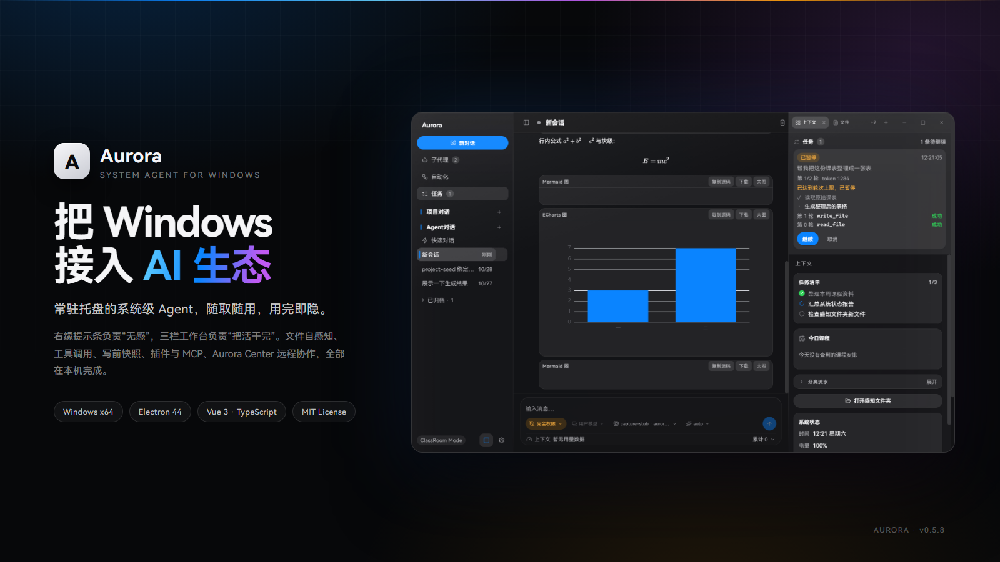
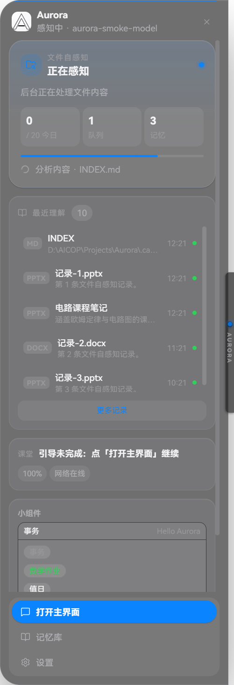
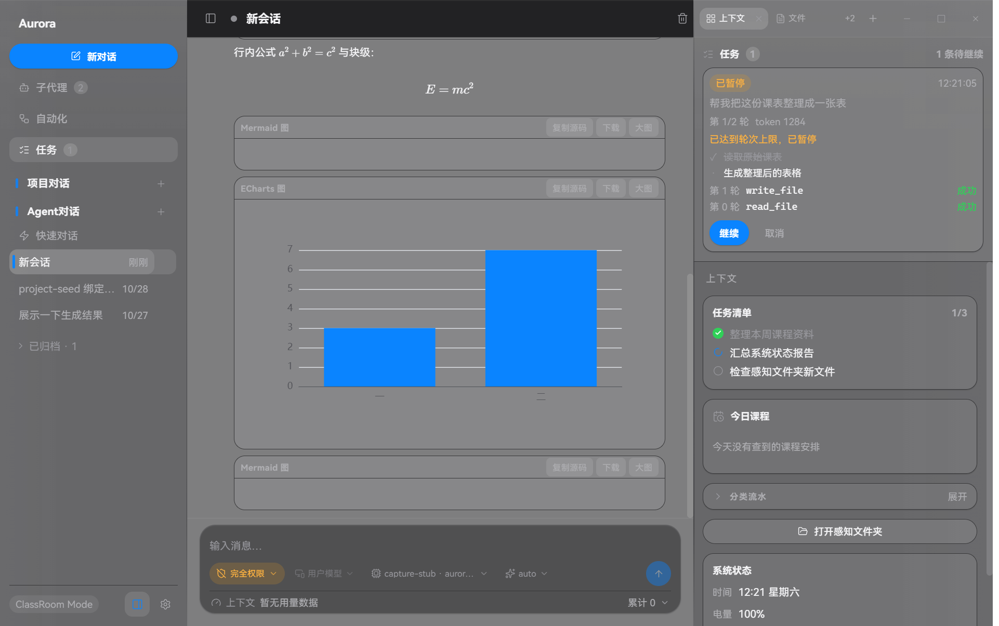
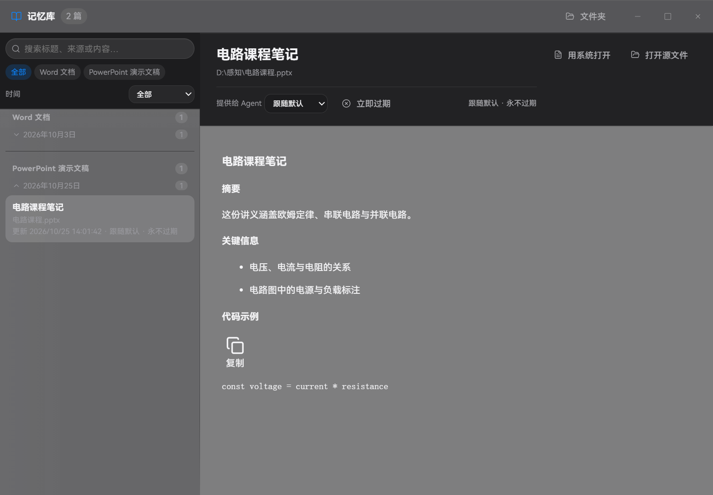
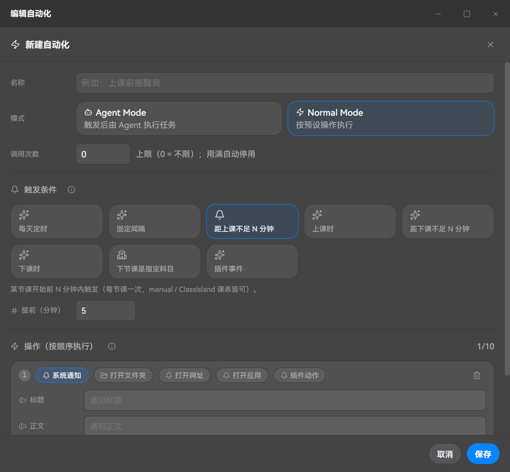
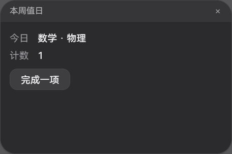
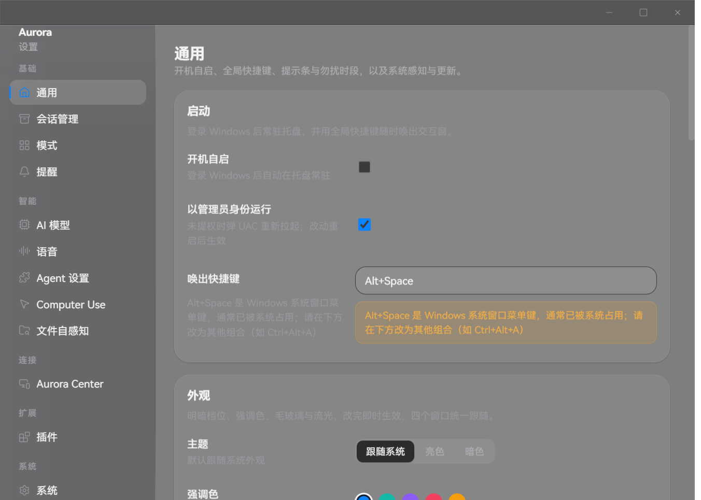
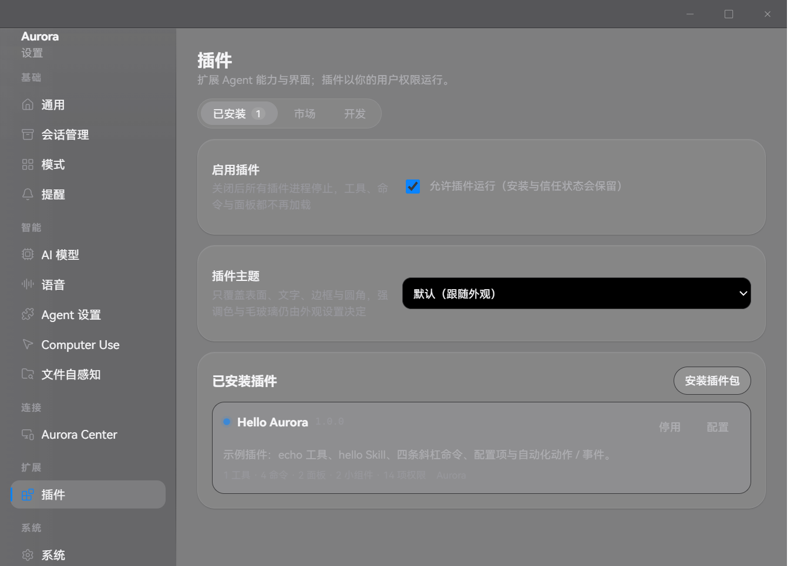
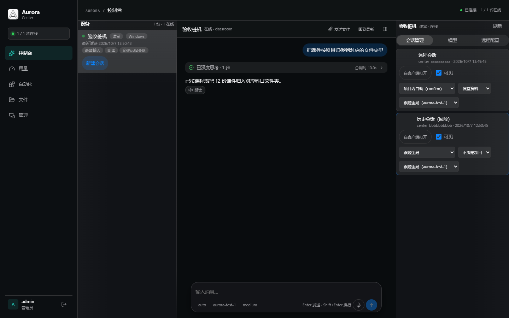
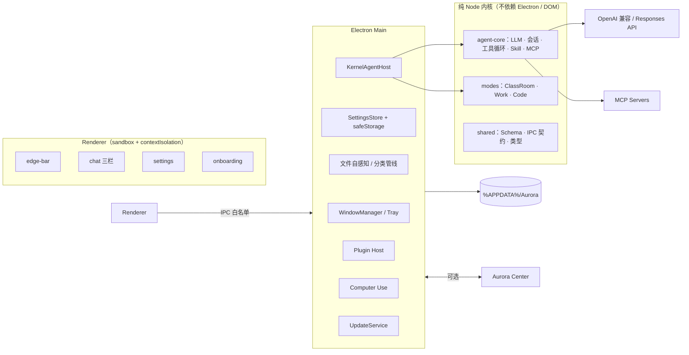

# Aurora

<p align="center">
  
</p>

<p align="center">
  <a href="./LICENSE"></a>
  
  
  
  
  <a href="https://github.com/LinePixel2025/Aurora/releases/latest"></a>
</p>

**Aurora** 是一款常驻 Windows 系统托盘的**系统级 AI Agent**。它把「AI 对话」做成系统的一部分：屏幕右缘一条 8px 的提示条负责随取随用，三栏工作台负责把活真正干完——读文件、跑命令、操作 Office、开浏览器、执行自动化，所有动作都有确认、快照与回滚。

> **当前发布：v0.5.8**（Windows x64，未签名）。`main` 分支已包含 Computer Use 桌面操控（配置 Schema v39，尚未发版）。
> 发布说明与安装包见 [Releases](https://github.com/LinePixel2025/Aurora/releases)。

---

## 目录

- [为什么是 Aurora](#为什么是-aurora)
- [界面一览](#界面一览)
- [能力地图](#能力地图)
- [安装与使用](#安装与使用)
- [本地开发](#本地开发)
- [工程结构](#工程结构)
- [架构](#架构)
- [发布与自动更新](#发布与自动更新)
- [插件开发](#插件开发)
- [安全与隐私](#安全与隐私)
- [文档](#文档)
- [参与贡献](#参与贡献)
- [许可证与致谢](#许可证与致谢)

---

## 为什么是 Aurora

大多数 AI 工具是一个网页、一个窗口、一个需要你主动打开的 App。Aurora 换了一个假设：**AI 应该像系统能力一样常驻，但只在需要时出现**。

| | Aurora 的做法 |
|---|---|
| **不抢注意力** | 常驻托盘，默认只占屏幕右缘 8px；悬停展开提示条，点击才拉出完整工作台，关闭 = 隐藏 |
| **真的能干活** | 工具调用循环 + 文件 / 命令 / Office / 浏览器 / 终端 / 子代理，不是“只给建议” |
| **可感知、可主动** | 时间、电源、网络、前台窗口、课程表、文件变化都进入上下文；新文件自动分类、课前自动提醒 |
| **可回滚** | 写文件前先做快照；敏感工具默认二次确认；每个动作都有执行轨迹 |
| **可扩展** | Skill、MCP、插件（工具 / 面板 / 小组件 / 主题 / 配置）与自托管 Aurora Center |
| **本地优先** | 配置、会话、记忆、日志都在本机；API Key 用系统安全存储加密，日志与导出统一脱敏 |

---

## 界面一览

### 右缘提示条：无感入口

收起时只是一条 8px 的光带；悬停展开「自感知工作台」——最近理解的文件、正在分析的内容、待办、插件小组件与快捷入口都在这里。

<p align="center">
  
</p>

### 三栏工作台：把活干完

左侧会话与项目，中间对话 / 执行轨迹，右侧是文件、浏览器、终端、任务、上下文多标签。思考、工具调用、确认卡、任务清单都收在同一条时间线上。

<p align="center">
  
</p>

### 文件自感知与记忆库

把文件拖进「智慧感知文件夹」，Aurora 会提取内容、判断科目、自动归档；理解结果沉淀为可检索、可过期、可提供给 Agent 的 Markdown 笔记。

<p align="center">
  
</p>

### 自动化：规则替你重复

定时、固定间隔、课前 / 课后、指定科目、插件事件都能触发；动作可以是系统通知、打开文件夹 / 网址 / 应用，也可以交给 Agent 执行完整任务。

<p align="center">
  
</p>

### 流光提醒与桌面小组件

提醒不只是一个弹窗：顶部光谱流光 + 可点击卡片，支持提示音、语音朗读、大小与停留时长；插件还能把信息做成不抢焦点的桌面小组件。

<p align="center">
  
  
</p>

### 设置与插件

开机自启、快捷键、主题 / 毛玻璃 / 强调色、模型与语音、Agent 权限、文件自感知、Aurora Center、插件与系统页，全部在一个设置窗口里。

<p align="center">
  
  
</p>

### Aurora Center：自托管控制中心

浏览器里的控制台：设备在线状态、远程会话、文件双向传输、官方模型网关、插件市场与用量统计。桌面端可选连接，不连接也完整可用。

<p align="center">
  
</p>

> 截图来自开发预览环境（模型为离线桩服务 `capture-stub`），用于展示布局与交互；正式使用前请在引导页配置自己的模型。

---

## 能力地图

### Agent 内核

- **多模型流式对话**：OpenAI 兼容协议、Responses API、多模态输入、思考过程与用量统计
- **工具调用循环**：同轮并发批次、失败回填不中断、abort 贯穿 HTTP 流
- **Skill**：`SKILL.md` 指令包，按需注入，不自动执行脚本；支持 `/skill`、`@skill` 显式调用
- **MCP**：自研最小 JSON-RPC 客户端，stdio + streamable-http，多连接管理与懒连接
- **会话**：本地持久化、损坏重建、字符预算截断、自动标题、项目 / Agent / 快速会话分组
- **子代理**：并行、可写、可续跑，写权限按实际授予结果落盘
- **上下文**：感知摘要 + 人设 + 模式片段 + Skill / 工具清单，超长自动摘要压缩
- **确认与回滚**：敏感工具二次确认、写前快照、执行轨迹可回看

### 模式

| 模式 | 状态 | 说明 |
|---|---|---|
| **ClassRoom** | 完整实现 | 智慧感知文件夹、科目自动分类、ClassIsland 课表、课前提醒、对话式引导 |
| **Work** | BetaV2 | Office 结构化读写、PDF 导出、剪贴板、文件与项目上下文 |
| **Code** | 接口预留 | 模式框架与能力位已就绪，功能实现待后续版本 |

### 扩展与系统能力

- **自动化**：定时 / 间隔 / 上课 / 下课 / 指定科目 / 插件事件；Agent Mode 与 Normal Mode
- **插件系统**：工具、Skill、斜杠命令、右栏面板、桌面 / 提示条小组件、主题、配置项、自动化动作
- **插件市场**：Aurora Center 上架、下载、校验与更新；页面型插件运行在沙箱 iframe
- **内置浏览器**：Agent 可打开、读取、截图、点击真实页面（受单独开关与并发槽位限制）
- **Computer Use（main 开发中）**：多模态模型 + 用户显式授权后截屏、移动虚拟光标、点击 / 输入 / 滚轮，退出即回前台
- **Aurora Center**：远程会话、文件双向、确认卡网页批复、官方模型网关、插件面板镜像
- **系统感知**：时间、电源、网络、前台窗口、显示器、今日课程；可配置的自感知流光

---

## 安装与使用

### 直接安装

1. 打开 [Releases](https://github.com/LinePixel2025/Aurora/releases/latest)，下载 `Aurora-Setup-<版本>.exe`
2. 双击安装（当前安装包**未做代码签名**，SmartScreen 会提示「未知发行者」）
3. 点「更多信息」→「仍要运行」，按引导完成 AI 模型配置

首次启动流程：欢迎 → **AI 模型配置（必填）** → 模式选择 → ClassRoom 设置 → 完成。
之后 Aurora 常驻托盘，右缘出现提示条；配置写入 `%APPDATA%/Aurora/config.json`，API Key 由系统安全存储加密。

> 系统要求：**Windows 10 / 11 x64**。安装包为 NSIS，非 oneClick，可自选安装目录；
> 卸载默认保留 `%APPDATA%/Aurora` 中的配置、会话与记忆。

### 从源码运行

需要 **Node.js ≥ 20.19** 与 **pnpm 11.15.1**（`packageManager` 已固定，建议用 Corepack）。

```powershell
pnpm install     # 首次会下载 Electron 运行时（约 100MB）
pnpm dev         # 启动 Electron：托盘 + 首次引导窗口
```

如果企业代理 / 证书拦截导致 Electron 下载失败：

```powershell
$env:ELECTRON_MIRROR='https://npmmirror.com/mirrors/electron/'
pnpm --filter @aurora/desktop exec electron --version
```

---

## 本地开发

```powershell
pnpm typecheck    # 全仓 tsc / vue-tsc
pnpm test         # vitest 全量单测
pnpm lint         # ESLint
pnpm format       # Prettier
pnpm build        # shared / agent-core / modes + Electron 产物（apps/desktop/out）
pnpm verify       # 真实磁盘的配置层验收（需先 build）
pnpm package      # 构建 + electron-builder NSIS 安装包
```

### 端到端自测（真实 Electron + IPC，离线可跑）

```powershell
$env:AURORA_SMOKE='1'; pnpm dev
Get-Content "$env:TEMP\aurora-smoke-logs\aurora-*.log" | Select-String 'AURORA_SMOKE_RESULT'
```

自测使用临时 `userData` 与本地假 LLM 桩服务，覆盖 `window.aurora` 暴露面、配置读写、凭据加密、引导流程、窗口状态机、真实对话流式、工具卡片、MCP 状态等链路。约 40 秒，结束后自动退出。

### 前端视觉验收

```powershell
$env:AURORA_CAPTURE="$env:TEMP\aurora-capture"; pnpm dev
```

四个窗口、提示条两态、设置页各页、主界面三栏与各条 DOM 探针会截成一批 PNG 并写 `report.json`；只截部分窗口用 `AURORA_CAPTURE_WINDOWS`，再细一级用 `AURORA_CAPTURE_ONLY`。规则见 [docs/07 §5.3](./docs/07-ui-spec.md)。

### CI

`.github/workflows/ci.yml` 为**手动触发**，顺序执行 `format:check → lint → typecheck → test → build`。日常验证以本地全量命令为准；需要干净环境时在 Actions 页面 Run workflow，或：

```powershell
gh workflow run ci.yml
```

---

## 工程结构

```text
apps/desktop/
  src/main/          Electron 主进程：托盘、窗口、配置、文件监听、分类管线、
                     系统感知、主动引导、Agent 装配、IPC、插件宿主、Computer Use
  src/preload/       沙箱化 contextBridge 白名单（自包含，不解析工作区包）
  src/renderer/      edge-bar / chat / settings / onboarding 四个窗口入口 + shared
packages/shared/     配置 Schema、SettingsStore、IPC 契约、模式 / 窗口类型、
                     桌面与 Center Web 共用的渲染器与设计令牌
packages/agent-core/ Agent 内核：LLM / 会话 / 工具循环 / Skill / MCP / Prompt 组装
packages/modes/      IMode 框架、ClassRoom 完整实现、Work（BetaV2）/ Code 占位
packages/center/     Aurora Center 服务器 + CLI + Web UI（可跨端 Node 服务）
skills/              内置 SKILL.md（file-classify / system-status / timetable）
integrations/        ClassIsland 桥接插件源码（C# / .NET 8）
examples/plugins/    插件示例与模板
plugin-dev-kit/      可整体拷走的插件开发工具包（契约 + 模板 + 校验器）
docs/                项目文档（单一事实来源）
```

**版本号以各 `package.json` 为准**；当前进度与设计以 [`docs/README.md`](./docs/README.md) 为准。

---

## 架构



几条关键约束：

- `agent-core` 与 `modes` 不依赖 Electron / DOM，可独立单测；
- preload 自包含，IPC 通道表与 `shared` 有编译期双向断言；
- 渲染层只允许类型导入，运行时值从 `@aurora/shared/browser` 取；
- 重任务（文档提取等）走 `utilityProcess`，不阻塞主进程；
- 桌面与 Center Web 共用 Markdown 渲染器、设计令牌与图标清单。

---

## 发布与自动更新

从 v0.5.8 起，**源码与安装包都在本仓库**：

| 位置 | 内容 |
|---|---|
| `LinePixel2025/Aurora` Releases | `Aurora-Setup-<版本>.exe`、`*.blockmap`、`latest.yml` |
| Aurora Center 更新源 | 同一批产物（可选自托管） |

客户端更新顺序：**Aurora Center 更新源 → 本仓库 GitHub Releases → 包内 `app-update.yml`**。更新资产三件套必须版本、size 与 sha512 一致。

```powershell
pnpm release -- --notes-file docs/release-notes/v<版本>.md
pnpm release -- --publish --publish-center --center-url <Center 地址> --center-user admin --push \
  --notes-file docs/release-notes/v<版本>.md
```

发布硬规则：每个版本的 `docs/release-notes/vX.Y.Z.md` 必须相对上一版本 tag 汇总全部更新点；annotated tag 正文与 Release 正文同源；桌面安装包必须同时上传 GitHub Releases 与 Aurora Center（双投）。

> 2026-10-25 及以前，安装包放在独立的 `Aurora-releases` 仓库；2026-10-31 开源后已统一到本仓库。
> 已安装的旧版本若未配置 Center，其内置 GitHub 回退源仍指向旧仓库，请手动下载新安装包覆盖安装。

---

## 插件开发

插件可以贡献工具、Skill、斜杠命令、右栏面板、桌面 / 提示条小组件、主题、配置项与自动化动作。清单是唯一入口，运行期不动态注册。

```text
my-plugin/
  manifest.json      # 清单：id / 权限 / 贡献
  main.js            # 插件进程入口
  ui/                # 可选：面板 / 页面 / 小组件
  skills/            # 可选：SKILL.md
```

- 工具名统一为 `plugin.<id>.<name>`，默认 `confirm`，用户信任后才应用清单里的 `safe`；
- 只读档只注册 `readonly: true` 的插件工具；
- 页面型插件运行在沙箱 iframe，只能经 postMessage 桥通信；
- 安装即信任：插件进程不是 OS 沙箱，安装前请审查源码。

完整契约见 [docs/14](./docs/14-plugin-system.md) 与 [docs/15](./docs/15-plugin-development-guide.md)，可整体拷走的工具包见 [`plugin-dev-kit/`](./plugin-dev-kit/README.md)，示例见 [`examples/plugins/`](./examples/plugins/)。

---

## 安全与隐私

- **凭据**：API Key / MCP 环境变量经 Electron `safeStorage` 加密后写入 `config.json`；安全存储不可用时只驻留内存。`settings:get` 与 `settings:changed` 只回传 `apiKeySet` / `envSet` 标记。
- **日志与导出**：`%APPDATA%/Aurora/logs/`（按天轮转保留 7 天）与「导出脱敏配置」中的凭据一律 `***`。
- **进程隔离**：渲染进程启用 `contextIsolation` + `sandbox`，只能通过 preload 白名单调用主进程能力。
- **命令执行**：MCP 服务器以用户显式配置的 argv 数组启动，绝不经过 shell；Skill 自带 `scripts/` 不会自动执行；敏感工具执行前需确认。
- **文件边界**：项目根有两层判定（弹卡用字符串、能否操作由 realpath 前缀校验）；写文件前先快照，主写失败不回滚快照。
- **网络**：所有出网走统一 `netFetch`，支持系统代理；会话内容只发送给用户自己配置的模型服务，不上传第三方。
- **Computer Use**：必须由用户显式授权、模型支持视觉、且非只读档；授权只在内存、按会话、同时一个；Aurora 自身 / 终端 / 任务管理器 / UAC / 锁屏始终受保护。

Aurora 不做遥测。数据位置、出网场景与权限清单见 [docs/11-privacy.md](./docs/11-privacy.md)。

---

## 文档

[`docs/`](./docs/README.md) 是项目的**单一事实来源**：

| 文档 | 内容 |
|---|---|
| [01 项目总览](./docs/01-overview.md) | 产品定位、设计原则、核心概念、范围与验收 |
| [02 系统架构](./docs/02-architecture.md) | 进程 / 模块 / IPC / 数据流 |
| [04 实现路径](./docs/04-roadmap.md) | 阶段、里程碑与逐轮实现记录 |
| [05 模式系统](./docs/05-mode-system.md) | ClassRoom / Work / Code 与分类管线 |
| [06 Agent 内核](./docs/06-agent-core.md) | LLM、会话、循环、Skill、MCP、感知、Computer Use |
| [07 界面规格](./docs/07-ui-spec.md) | 窗口体系、设计令牌、动效与验收探针 |
| [08 设置与引导](./docs/08-settings-onboarding.md) | 配置 Schema、存储安全、首次引导 |
| [09 打包发布](./docs/09-packaging-release.md) | NSIS、自动更新、双投与发布口径 |
| [10 用户手册](./docs/10-user-guide.md) | 安装、窗口、模式、排障 |
| [11 隐私说明](./docs/11-privacy.md) | 数据位置、凭据加密、出网场景 |
| [12 Aurora Center](./docs/12-aurora-center.md) | 服务器 / Web UI / CLI / 连接器 |
| [13 自动化](./docs/13-automation.md) | 触发器、动作组件、内置自动化 |
| [14 插件系统](./docs/14-plugin-system.md) / [15 插件开发](./docs/15-plugin-development-guide.md) | 清单、权限、RPC、面板、市场与开发指南 |

---

## 参与贡献

- **Issue**：Bug 请附版本、复现步骤与日志片段（日志在 `%APPDATA%/Aurora/logs/`，注意脱敏）；功能建议请说明使用场景。
- **PR**：从 `main` 开短命分支，提交信息用 Conventional Commits（`feat:` / `fix:` / `docs:` …）；改动涉及配置 Schema、IPC 契约、两端共享渲染资产或发布流程时，先读 [AGENTS.md](./AGENTS.md) 与 [docs/09](./docs/09-packaging-release.md)。
- **文档先行**：改行为前先改 `docs/`；配置字段与 IPC 契约以文档为准。
- **提交前**：至少跑 `pnpm typecheck && pnpm test && pnpm build`；前端改动再跑一次 `AURORA_CAPTURE` 截图核对。

这个项目由单人长期开发，欢迎任何形式的反馈：Issue、PR、插件、文档修正，或者只是告诉我在什么场景下用得上。

---

## 许可证与致谢

以 [MIT License](./LICENSE) 开源，Copyright © 2026 LinePixel2025。

Aurora 站在许多优秀开源项目之上：Electron、Vue 3、Vite、electron-vite、electron-builder、markdown-it、Mermaid、ECharts、KaTeX、lucide、xterm.js、node-pty、chokidar、fflate、officeparser、pdf-lib、systeminformation、ws。字体使用 HarmonyOS Sans（随包附带许可证），Office 结构化能力由固定版本 OfficeCLI 提供，ClassIsland 课表通过独立桥接插件接入。感谢这些项目的作者与维护者。

---

<p align="center">
  <sub>Aurora —— 常驻而克制，主动而不冒犯。</sub>
</p>
